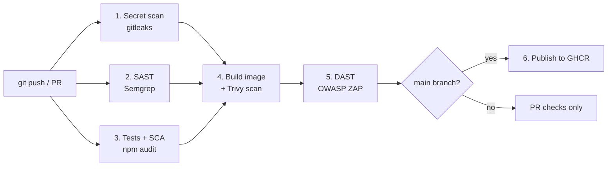

# DevSecOps CI/CD Pipeline


A **shift-left security** pipeline built with GitHub Actions. Every push and pull request goes through
secret scanning, SAST, dependency scanning, container scanning and DAST. Code that fails a security
gate **cannot reach the container registry**.

The app being protected is a small Node.js / Express Notes API, hardened with Helmet, input validation,
a hardened non-root container and safe error handling.

## Pipeline



| Stage | Tool | What it catches | Gate (fails the build) |
|---|---|---|---|
| 1. Secret scan | gitleaks | API keys, tokens, passwords in code **and git history** | Any secret found |
| 2. SAST | Semgrep (`p/javascript`, `p/owasp-top-ten`) | Injection, eval, insecure code patterns | ERROR severity findings |
| 3. SCA | npm audit | Vulnerable npm packages | High / Critical |
| 4. Container scan | Trivy | OS + library CVEs, Dockerfile misconfigurations | High / Critical (fixable) |
| 5. DAST | OWASP ZAP baseline | Missing security headers, info leaks in the running app | Rules marked FAIL in `.zap/rules.tsv` |
| 6. Publish | GHCR | — | Runs only if 1–5 pass on `main` |

All scanner results (gitleaks, Semgrep, Trivy) are uploaded as **SARIF** to the repo's
**Security → Code scanning** tab, so findings are tracked in one place.
**Dependabot** opens PRs for outdated or vulnerable dependencies, which then go through the same pipeline.

## Security hardening in the app and image

- `helmet()` sets CSP, X-Frame-Options, X-Content-Type-Options, HSTS, etc.
- `X-Powered-By` disabled (no technology fingerprinting)
- JSON body size limit (10 KB) and input validation
- Error handler never leaks stack traces
- Multi-stage Docker build, only production dependencies
- npm / npx / yarn / corepack **removed** from the runtime image (smaller attack surface)
- Container runs as **non-root** user `node`, with a `HEALTHCHECK`
- Scanner versions pinned in the workflow (supply-chain safety)

## Run locally

```bash
npm install        # first time: also creates package-lock.json (commit it)
npm test           # unit tests
npm start          # http://localhost:3000
```

With Docker:

```bash
docker build -t devsecops-notes .
docker run -d -p 3000:3000 --name notes devsecops-notes
curl http://localhost:3000/health
```

Try the API:

```bash
curl -X POST http://localhost:3000/api/notes -H "Content-Type: application/json" -d '{"text":"first note"}'
curl http://localhost:3000/api/notes
```

## Proof: the pipeline catches real issues

See [docs/BREAK-THE-PIPELINE.md](docs/BREAK-THE-PIPELINE.md): five deliberate mistakes, each caught by a different stage.

| Experiment | Caught by | Screenshot |
|---|---|---|
| Hardcoded GitHub token | gitleaks | _add screenshot_ |
| `eval()` on user input | Semgrep | _add screenshot_ |
| `lodash@4.17.15` | npm audit / Trivy | _add screenshot_ |
| `node:14-alpine` base image | Trivy | _add screenshot_ |
| Helmet removed | OWASP ZAP | _add screenshot_ |

## Handling findings

- **Real issue:** fix it in code and push again.
- **False positive / accepted risk:** document it. Add the CVE to `.trivyignore` with a reason,
  or add a `// nosemgrep: <rule-id>` comment with a justification. Never silently disable a scanner.

## Roadmap

- [ ] Send all findings to **DefectDojo** for central vulnerability management
- [ ] Generate an **SBOM** (Trivy / Syft) and attach it to each image
- [ ] **Sign images** with cosign and verify the signature before deploy
- [ ] Scan Terraform / Kubernetes manifests with Checkov
- [ ] Deploy to a Kubernetes cluster (kind) with Kyverno admission policies

## Tech stack

GitHub Actions · Docker · Node.js / Express · gitleaks · Semgrep · npm audit · Trivy · OWASP ZAP · GHCR · Dependabot
